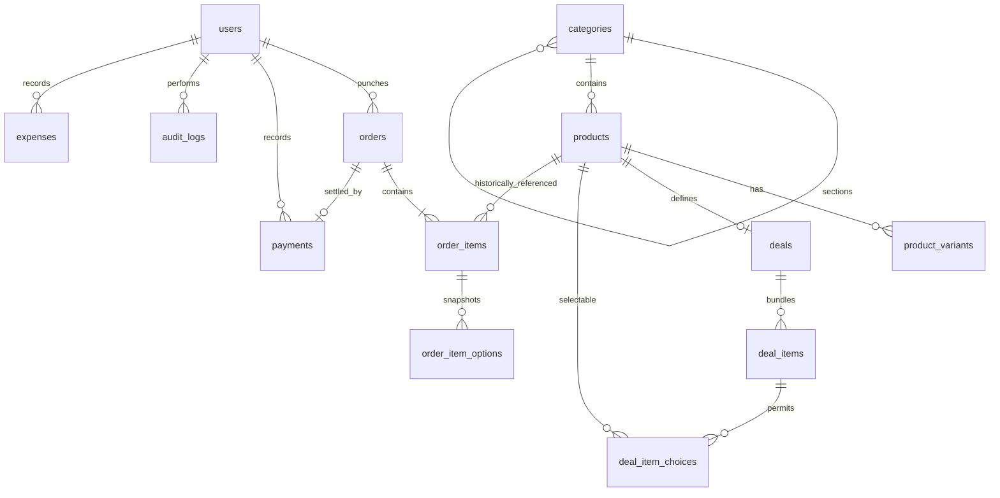

# The Hungry Spot — implementation architecture

Native SwiftUI macOS 12 Monterey application, with an AppKit printing/image bridge and an offline SQLite store. No server, cloud service, package download or internet connection is required to run the application. SQLite is accessed through a small prepared-statement layer over Apple's system SQLite library. The Swift tools floor is 5.7 for Xcode 14.2 on the owner's Intel Mac; navigation, image drops, forms and sales bars use APIs available on Monterey.

## Layers and ownership

- `HungrySpotCore/Domain`: value models, integer-paisa money, permission and workflow rules.
- `HungrySpotCore/Persistence`: serialized SQLite connection, versioned migrations, one-time seed, normalized tables and indexes.
- `HungrySpotCore/Services`: authentication, catalog management, authoritative pricing, transaction-safe orders and payments, reporting, expenses and auditing.
- `HungrySpot/Infrastructure`: optimized local images, native print dialogs, verified backups and restore.
- `HungrySpot/Views`: observable session, native sidebar, cashier and admin screens. Views call services; they never write SQL or authorize themselves.

All database work is serialized. Each service revalidates the persisted user and role, rather than trusting a visible navigation item. A first-run administrator chooses credentials; there are no shipped passwords. Passwords use salted PBKDF2-HMAC-SHA256. Money is stored as integer paisa. Paid order snapshots determine historical totals; current catalog prices never rewrite history.

## Database ERD

## Models and navigation

The full Swift model contract is `Sources/HungrySpotCore/Domain/Models.swift`. Major models are User, Category, Product, ProductVariant, Deal, DealSlot, CartLine, Quote, OrderRecord, OrderItemSnapshot, Payment, Expense and ReportSummary. `AppSettings` persists business identity, currency, printer choices, delivery presets and discount permission.

First launch → secure administrator setup → authenticated session. Administrator navigation: Dashboard, POS, Orders, Menu, Categories, Deals, Sales, Expenses, Audit Log, Settings (including users/backup/restore). Cashier navigation: POS, Orders and availability-only Menu. A dedicated service updates only product availability; full catalog edits remain administrator-only. Logout destroys the session and draft cart. Price quotes are previews; punch recalculates against the current database inside the save transaction.

## Screens

Setup/login; dashboard/date range; POS/search/category grid/cart; variant/pizza/deal configuration; delivery details; current orders/history/detail/payment; product/variant/image editor; category editor; deal/slot/choice editor; sales reports; expense editor; audit log; business/printer/delivery/user/backup settings.

## Business uncertainties

See BUSINESS_RULES.md. Pizza eligibility and Family Pan Pizza must be explicitly configured before affected deals can be sold. They will be visibly marked for review, not guessed. Cashier discounts default to disabled pending an administrator's explicit setting. No taxes, refunds, split tender, inventory accounting or table management are inferred from the brief.

## Build verification boundary

Development is taking place on Windows with no Xcode/macOS SDK. SQL and seed integrity can be exercised locally. Swift unit tests, native compilation, UI interaction, printer behavior and signing require a Mac and are not represented as passed until actually run. Release scripts stop on errors and perform tests before packaging.
